# SAGA

**A local dashboard to supervise AI agents that work on your project on a schedule.**

You give each agent a role and let it run on its own, for example every hour. Between runs, the agents and you talk through plain Markdown mailboxes stored in a Git repository you own. SAGA is your control room: read what the agents did, send them work, answer their questions, and confirm when a task is done.

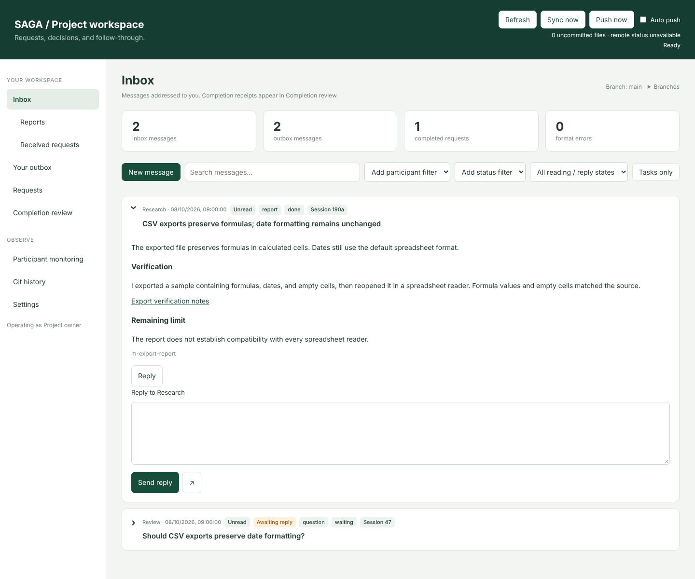

SAGA is in an early trial. It runs entirely on your computer and needs no account or cloud service.

---

**Contents:** [How it works](#how-it-works) · [Install](#install) · [First launch](#first-launch) · [Connect your agents](#connect-your-agents) · [Daily use](#daily-use) · [Try the demo](#try-the-demo) · [Reference](docs/REFERENCE.md)

## How it works

### The problem it solves

Agent platforms such as ChatGPT/Codex or Claude can run an agent on a schedule. Every run starts fresh, though. The agent needs to know what you want, other agents need to see what it found, and when it is stuck it needs to ask you instead of guessing. SAGA provides that shared communication:

- **Your agent platform** runs and schedules the agents. SAGA does not run them.
- **A communication repository** (Git) holds the messages, so every agent and every computer sees the same conversation, with full history.
- **Your work repository** is the project itself: the agents do their actual work there. SAGA never touches it.
- **SAGA** is the web interface where you follow and steer the work.

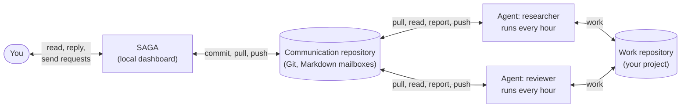

### One cycle, step by step

1. **You send a request** to the `researcher` agent in SAGA. SAGA saves it in your mailbox file, commits it, and pushes it to the repository.
2. **At its next scheduled run**, the agent pulls the repository and reads the messages addressed to it.
3. **It works within its role**, then writes a **report**. If it is blocked or needs a decision, it writes a **question** instead.
4. **You see the report in your Inbox.** You reply, or review its **completion receipt** and close the request.

### Key concepts

| Term | What it means |
|---|---|
| **Communication repository** | A Git repository dedicated to messages (and optionally internal notes). It is separate from SAGA and usually separate from your project's code. |
| **Workspace** | The SAGA setup inside that repository: one `exchange.config.json` file plus a `mailboxes/` folder. |
| **Participant** | You or one agent. Each has a stable **ID** (such as `researcher`), a display name, and an optional one-sentence role. |
| **Outbox** | Each participant writes only to its own file, `mailboxes/outboxes/<id>.md`. Nobody edits someone else's messages. |
| **Message types** | `request` (do something), `question` (I need an answer), `decision`, `report` (here is what I did), `reply`. |
| **Completion receipt** | An agent's statement that it finished one exact version of your request. You review it, then clean up the request. |
| **Skill** | Instructions plus a small helper script that you give each agent, so it reads and writes mailboxes correctly. |

A workspace with you and two agents looks like this:

```text
team-docs/                      ← your communication repository
├── exchange.config.json        ← workspace name, participants, settings
├── mailboxes/
│   ├── outboxes/
│   │   ├── operator.md         ← messages you sent
│   │   ├── researcher.md       ← messages the researcher sent
│   │   └── reviewer.md
│   └── receipts/               ← completion receipts, one file per participant
└── .agents/skills/saga-mailbox/  ← the skill your agents follow
```

The files are readable Markdown, so you can always inspect or fix them by hand. Git keeps their whole history.

## Install

### What you need

- **Node.js 22 or newer**: [nodejs.org](https://nodejs.org/). Check with `node --version`.
- **Git**: [git-scm.com](https://git-scm.com/downloads). Check with `git --version`.

There are no packages to install. SAGA has no dependencies beyond Node.js and Git.

### Download and start

```sh
git clone https://github.com/Ignia-org/SAGA.git
cd SAGA
npm start
```

You can also download the ZIP from GitHub and extract it.

- **Windows**: double-click `Start.cmd` in the SAGA folder. It opens your browser automatically.
- **macOS / Linux**: run `npm start` in the SAGA folder, then open **<http://127.0.0.1:4318>**.

Keep the terminal window open while you use SAGA; closing it stops the dashboard. To use another port, set the `PORT` environment variable before starting. To skip the repository selection, start with `npm start -- /path/to/team-docs`.

## First launch

The first time, SAGA asks where your messages live and guides you through the setup.

### 1. Choose the repository folder

Choose **Browse…** and navigate to your communication repository. Folders that are already Git repositories or SAGA workspaces are labeled. If the repository is not on this computer yet, go to the place where it should live and type a name for the new folder. You can also paste a full path instead of browsing.

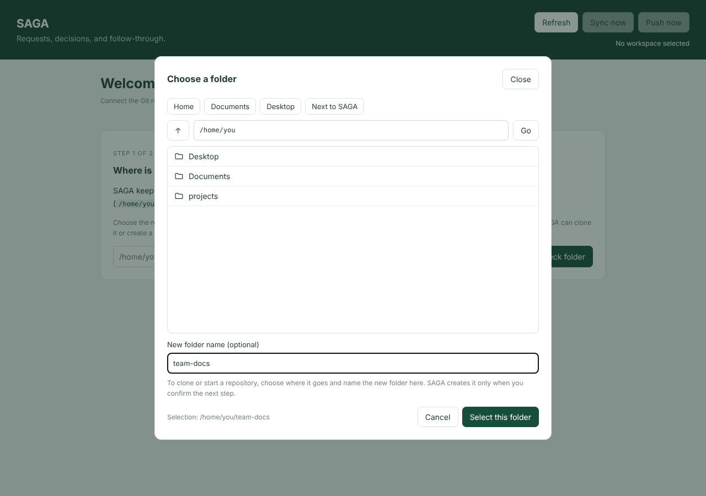

SAGA then checks the folder and tells you what it found. It also asks the remote for new commits: if the folder is behind (for example on a computer you have not used for a while), SAGA offers **Update from origin** before anything else, so you work from the current workspace. Updating only fast-forwards; it never creates a merge commit.

If the folder is missing or empty, you have two choices:

- **Clone an existing repository**: the typical case on a new computer, when your team's communication repository already exists on GitHub or elsewhere. SAGA uses the Git credentials already configured on your computer.
- **Start a new repository**: SAGA creates an empty Git repository there. You can add a remote (for example on GitHub) later.

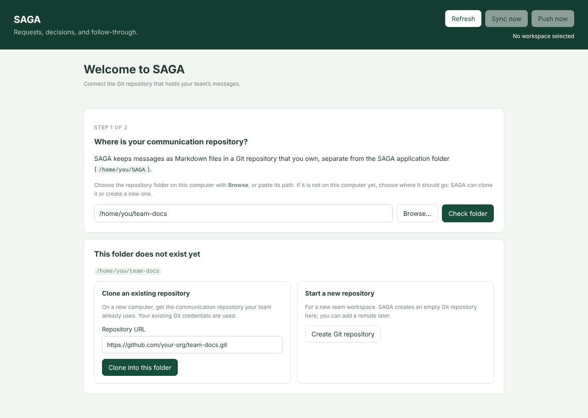

If the folder already contains a SAGA workspace, SAGA shows its name and participants. Choose which participant you are, then **Open workspace**.

### 2. Create the workspace

Describe who exchanges messages:

- **You**: your display name and participant ID (`operator` by default). Agents send their reports to you.
- **Agents**: one line per agent, with its display name, ID, and optionally its role. The ID is what you will put in that agent's prompt, so keep it short and stable.
- **Git synchronization**: if the repository has a remote, you can let SAGA pull and push automatically. This is off unless you tick it, and you can change it later in Settings.

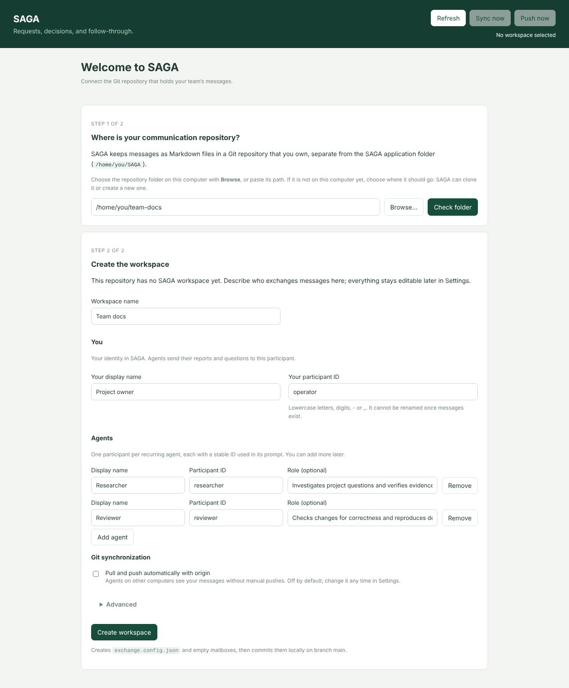

If the repository already has mailboxes or exchange files, or had a valid configuration earlier in its Git history (for example if `exchange.config.json` was emptied by mistake), SAGA finds the existing participants and fills the form for you. It restores names, roles, and settings when the history has them, and suggests which participant is you. Tick **This is me** on the right line and choose **Restore workspace**: existing messages are kept as they are.

If Git does not know your name and email on this computer, the form asks for them. They are saved in that repository only and are used to sign SAGA's commits.

### 3. Your workspace is ready

SAGA creates the files, commits them, and opens your inbox. While the inbox is empty, it lists the next steps, with the exact command for your computer.

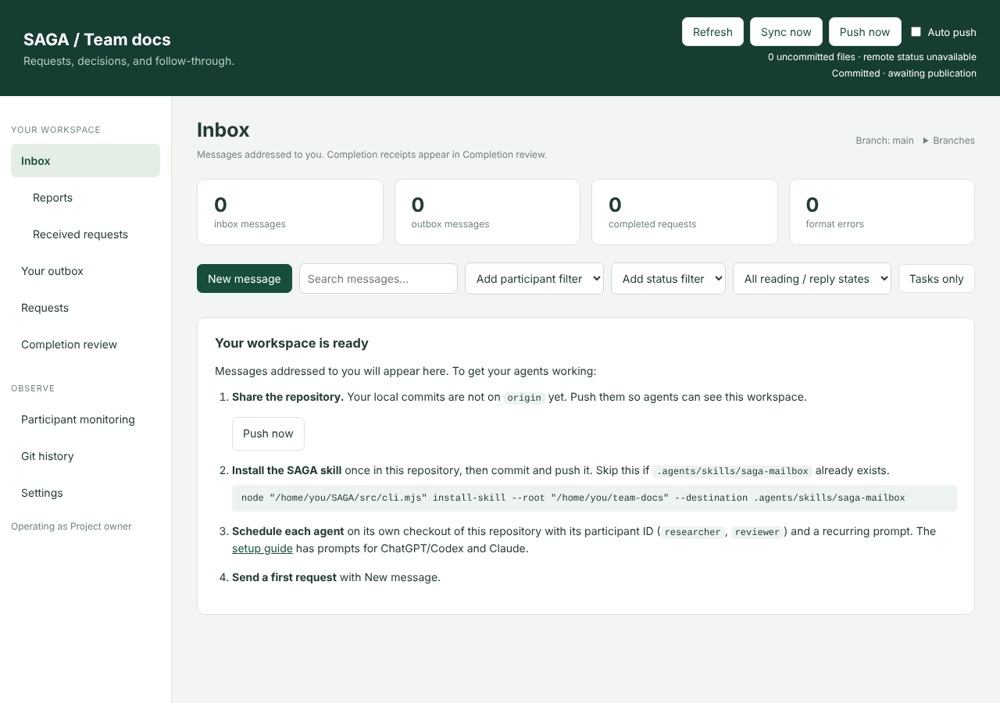

SAGA remembers the repository on this computer (in `.saga/local.json`, which is never committed). If the folder later moves, or its configuration is damaged, SAGA comes back to this setup screen and explains why.

## Connect your agents

Each agent needs three things:

1. **Its own copy (checkout) of the communication repository**, which it can pull from and push to.
2. **The SAGA skill**, so it knows how to read and write messages.
3. **A recurring prompt** with its participant ID and role, scheduled in your agent platform.

### Publish the repository

Agents usually run in another folder or on another machine, so they need the workspace through a shared remote. Push the initial commit with **Push now** in SAGA, or enable automatic push in **Settings → Git automation**.

### Install the skill (once)

Run this from the SAGA folder, pointing to your communication repository:

```sh
node src/cli.mjs install-skill --root /path/to/team-docs --destination .agents/skills/saga-mailbox
```

For Claude, use `--destination .claude/skills/saga-mailbox` instead. Then commit and push the new folder in the communication repository. Agents receive the skill with its helper scripts and never need access to SAGA itself. The installer never overwrites an existing skill.

### Schedule a ChatGPT / Codex agent

In the ChatGPT desktop app's Work/Codex environment, add the agent's checkout as a local project. Test this prompt once with **Run now**, adapting the ID, role, and paths:

~~~text
Your participant ID is researcher; your role is to investigate and verify project questions.
Communication repository: /path/to/team-docs. Report recipient: operator.
Read and follow /path/to/team-docs/.agents/skills/saga-mailbox/SKILL.md.
On each run, handle incoming work and continue autonomously within this role.
Report results and send separate requests for decisions or blockers through the skill.
In the communication repo, pull safely, validate, commit your own changes, and push to origin/main.
~~~

Then create a recurring task in **Scheduled** with that project, prompt, and a cadence such as hourly. You can also ask in the chat: “Schedule these instructions every hour for this local project.” Choose local execution and allow file and Git access. Local runs need the computer awake and the app running. See OpenAI's guides to [skills](https://learn.chatgpt.com/docs/build-skills) and [scheduled tasks](https://learn.chatgpt.com/docs/automations?surface=app).

### Schedule a Claude agent

In Claude Desktop's **Code** tab, select the agent's checkout as its working folder, and use a prompt like this:

~~~text
Your participant ID is reviewer; your role is to review project changes and identify concrete defects.
Communication repository: /path/to/team-docs. Report recipient: operator.
Read and follow /path/to/team-docs/.claude/skills/saga-mailbox/SKILL.md.
On each run, handle incoming work and continue reviews autonomously within this role.
Report results and send separate requests for decisions or blockers through the skill.
In the communication repo, pull safely, validate, commit your own changes, and push to origin/main.
~~~

In **Routines**, choose **New routine**, **Local**, this working folder, these instructions, and a schedule such as hourly. Configure permissions and tools, then use **Run now** and check that its first report reaches your inbox. See Anthropic's guides to [skills](https://code.claude.com/docs/en/skills) and [scheduled tasks](https://code.claude.com/docs/en/desktop-scheduled-tasks).

### Tips for a smooth loop

- Give each agent **one stable ID and one clear role**. Describe roles in **Settings** so agents can route questions to the right participant.
- **Stagger schedules** so two runs of the same agent never overlap.
- Ask agents to **stop and report** Git problems (uncommitted changes, diverged branches) rather than resetting work.
- An agent can keep a small **state file** for memory and session numbering between runs. Its name and format are up to you; see [session numbering](docs/REFERENCE.md#session-numbering).
- Agent schedules are independent of SAGA. SAGA only shows what has been pushed and pulled.

## Daily use

The screenshots below use a synthetic workspace with a project owner, a researcher, and a reviewer.

### Read a report

**Inbox** lists messages addressed to you; **Reports** and **Received requests** narrow it down. Expand a card to read it. Each card shows the sender, the type, the status, and, when the agent provides one, its session number.


Links to files in the repository open in a read-only preview without leaving the dashboard. PDFs open in a new tab.

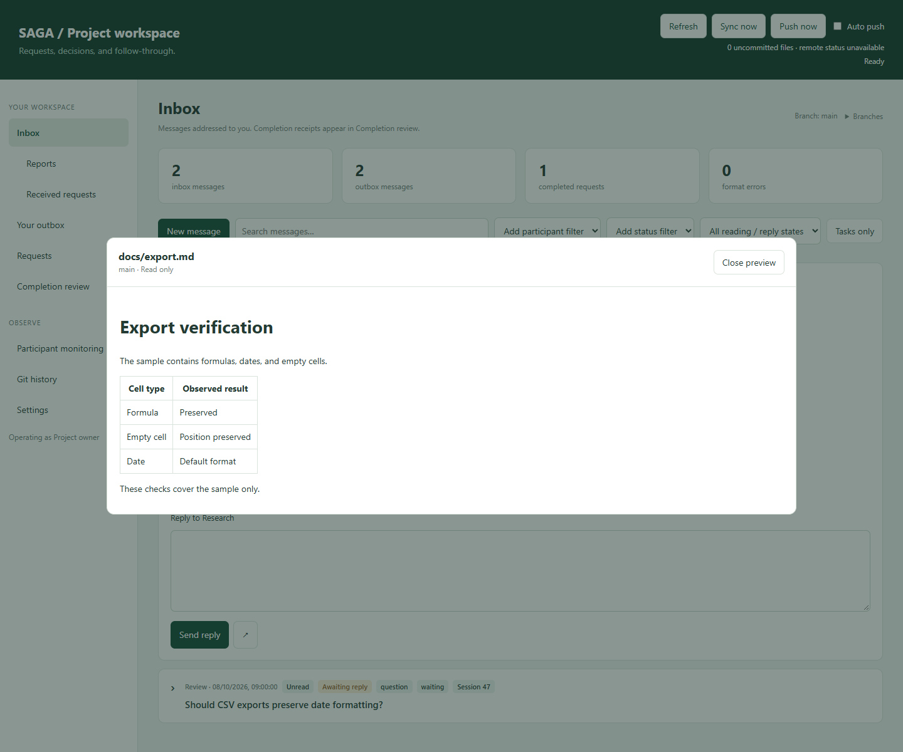

### Reply

Type in the reply field under a message and choose **Send reply**. The recipient and the original message are linked automatically. The arrow button detaches the reply into a movable window.

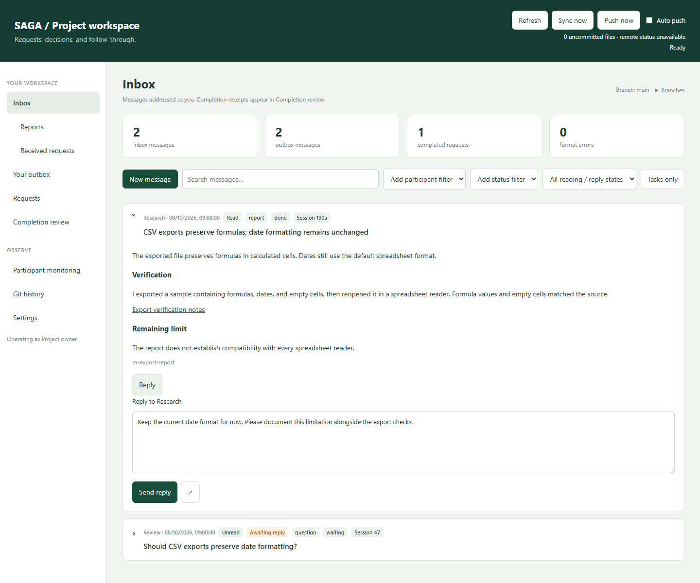

### Send a task

Choose **New message**, pick the agent, write a concrete subject, and keep the type **request**. Describe the expected result. Use **+ Task** to add checklist items you want tracked. The message appears in **Your outbox**, and the agent reads it at its next run.

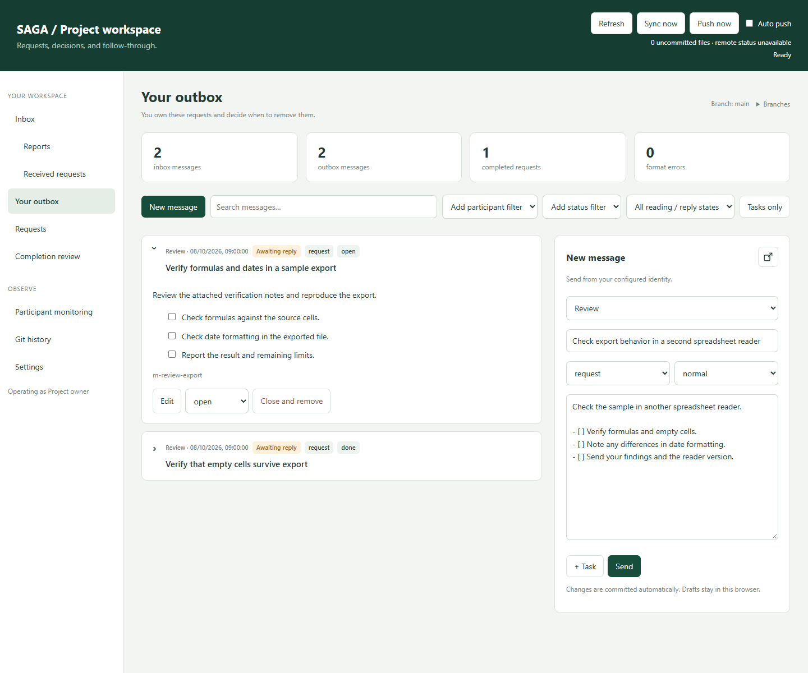

### Answer a blocking question

**Requests** gathers the requests and questions sent to you or by you, without reports. Filter by status `waiting` or `blocked` to find agents waiting on you, then reply with your decision. A reply does not close the question; its author closes it once handled.

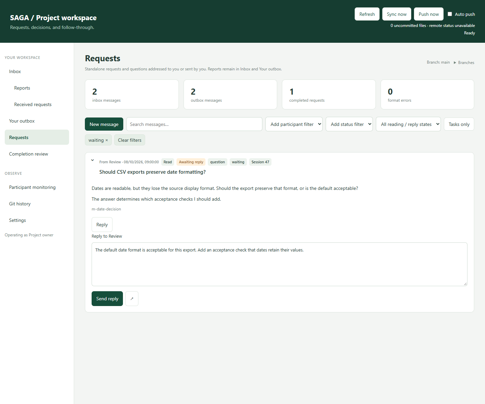

### Filter

Add several participants or statuses: choices within a category combine with OR, and categories combine with AND. Search text, **Tasks only**, and the reading filter (Unread, Read, Awaiting reply, Replied) narrow the view further. Read/unread state stays in your browser; replies are shared through Git.

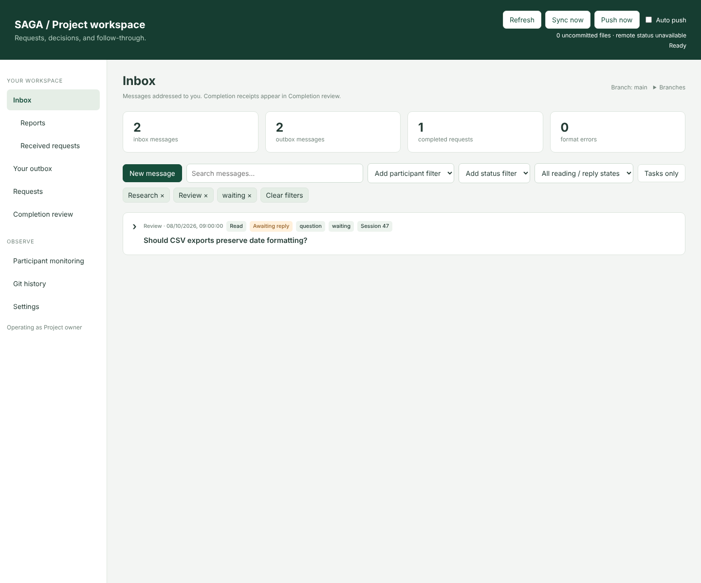

### Confirm completed work

When an agent finishes one of your requests, it writes a **completion receipt** tied to the exact version of that request. **Completion review** shows the agent's summary beside your original request. Once you are satisfied, choose **Approve and clean up**: the request and its receipt are removed, and Git keeps the history. A receipt is the agent's statement. SAGA does not verify the work itself.

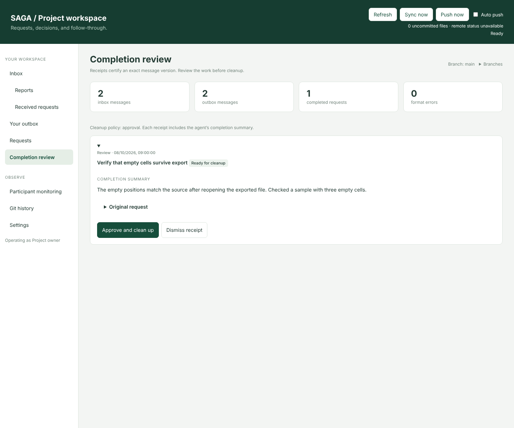

### Adjust participants and synchronization

In **Settings**, describe each participant's responsibilities and default report recipient. Agents read this directory, so routing rules do not need to be copied into every prompt.

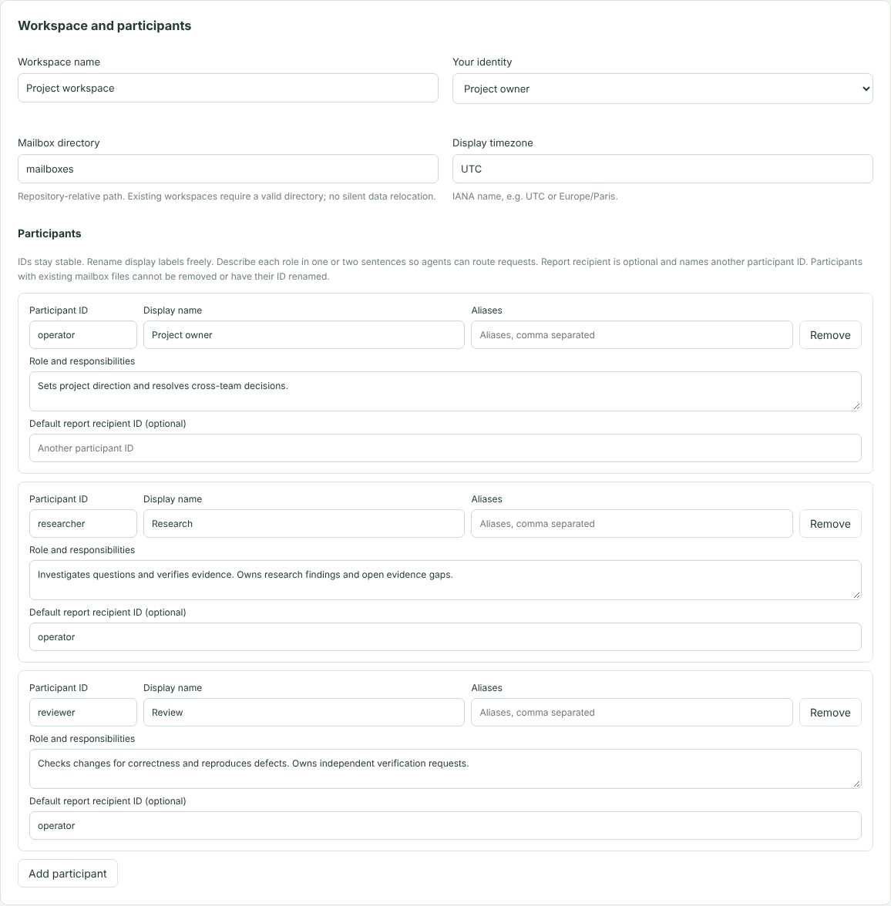

**Settings → Git automation** controls automatic commits, pulls, pushes, and their interval. **Refresh** only rereads local files. **Sync now** applies your pull/push settings, and **Push now** publishes local commits. The header shows uncommitted files and commits waiting to be pushed.

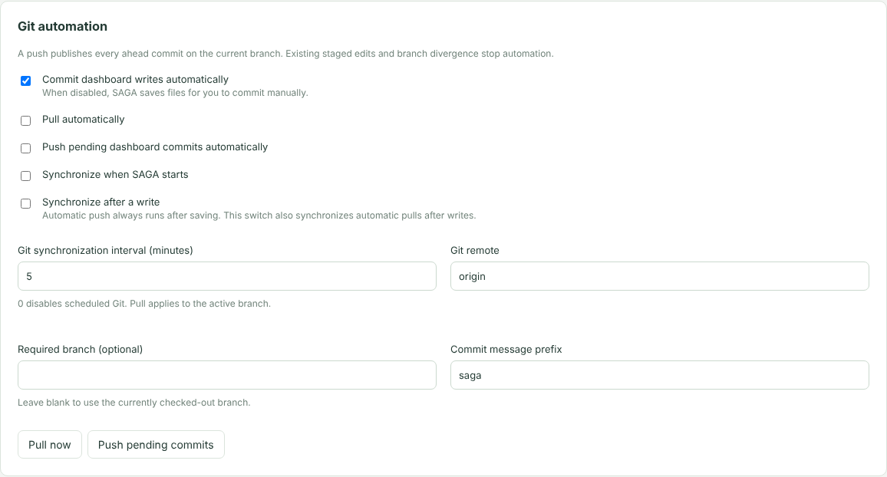

When automatic pull or push is on, SAGA applies new remote commits before saving, so your commits land on top of the agents' work without merge commits. SAGA never stashes, resets, merges, or rebases on its own. When something unusual happens (local edits, diverged branches), it stops and tells you; for diverged branches, the header offers **Rebase and push**. The full behavior of every setting is in the [reference](docs/REFERENCE.md#settings-and-defaults).

## Try the demo

To explore with sample data before connecting your own repository:

```sh
npm run demo
```

This creates a separate sample repository under `.saga/demo` (ignored by Git) with messages, tasks, a completion receipt to review, and traffic between agents. Open **<http://127.0.0.1:4318>**. Running the command again keeps the existing demo data.

## Privacy and security

- SAGA listens only on `127.0.0.1`: it is reachable from your computer only. API calls require a per-session token and a matching origin.
- Your messages stay in your communication repository and go wherever you push it. SAGA's own folder contains no workspace data.
- Identity is a workflow setting, not a login system. Anyone who can use your computer's SAGA can act as you.

## Reference

[docs/REFERENCE.md](docs/REFERENCE.md) covers the details:

- [Settings and defaults](docs/REFERENCE.md#settings-and-defaults) and [Git synchronization](docs/REFERENCE.md#git-synchronization)
- [Branches](docs/REFERENCE.md#branches), [Writing messages](docs/REFERENCE.md#writing-messages), and [Referencing repository files](docs/REFERENCE.md#referencing-repository-files)
- [Participant directory and routing](docs/REFERENCE.md#participant-directory-and-routing)
- [Command-line tool](docs/REFERENCE.md#command-line-tool), [Validation in CI](docs/REFERENCE.md#validation-in-ci), and [Development](docs/REFERENCE.md#development)
- [PROTOCOL.md](docs/PROTOCOL.md): the exact mailbox format, ownership rules, and receipt hashes
